<h3><code>codenamann@github ~ $ ./contributions.sh</code></h3>

  

<h3><code>codenamann@github ~ $ whoami</code></h3>

<table>
  <tr>
    <td valign="top"></td>
    <td valign="top"></td>
  </tr>
</table>

 

  <a href="https://linkedin.com/in/codenaman"><b>LinkedIn</b></a> &nbsp;·&nbsp;
  <a href="https://codenaman.netlify.app"><b>Portfolio</b></a> &nbsp;·&nbsp;
  <a href="mailto:namantiwari.dev@gmail.com"><b>Email</b></a>

---

### `$ cat tech-stack.txt`

`Java` · `JavaScript` · `React` · `Next.js` · `Node.js` · `Express.js` · `MongoDB` · `MySQL` · `Tailwind CSS` · `Git` · `GitHub`

> *"Turning coffee into code."*
